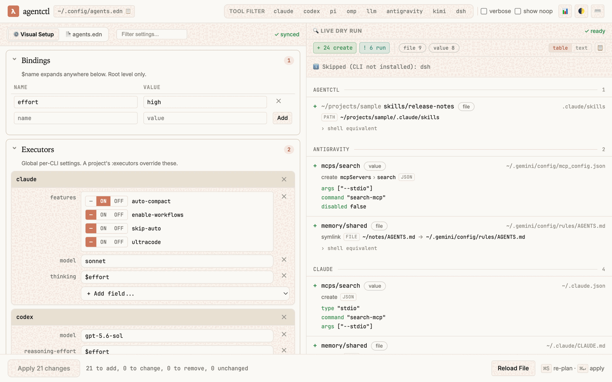

<h1 align="center">agentctl</h1>
<p align="center">Provisions settings, MCP servers, skills and memory for the coding-agent CLIs on your machine from one EDN file.</p>
<p align="center">
  <b>Stage:</b> alpha · <b>Target:</b> personal, published as-is · <b>License:</b> <a href="LICENSE">Apache-2.0</a>
  <br>
  <a href="#install">Install</a> · <a href="#usage">Usage</a> · <a href="#limitations">Limitations</a> · <a href="docs/GUIDE.md">Guide</a> · <a href="docs/AGENTCTL.md">Design and DSL</a>
</p>

<p align="center"></p>
<p align="center"><sub><code>agentctl gui</code> on a demo config in a scratch home with stub CLIs, captured with headless Chrome by <a href="docs/images/capture-gui.sh">capture-gui.sh</a>.</sub></p>

> [!WARNING]
> **Alpha.** Config keys change without migration: `:#let` became `:#def` with no alias, and an
> old file's `$name` references fall back to environment variables. 170 unit tests and five
> end-to-end suites pass in CI, but no `apply!` over a whole config on a real home has been done
> yet (#5). Beta when #5 is verified and
> #16 is fixed.

agentctl reads `~/.config/agents.edn`, compares it with the files each CLI keeps on disk, prints
a plan and applies only the changes it owns, in the manner of Terraform. It covers Claude Code,
Codex, Pi, OMP, Antigravity (`agy`), Kimi Code, the DeepSeek Harness (`dsh`) and Simon
Willison's `llm`; a tool whose CLI is not installed is skipped.

## Install

Requires [Babashka](https://babashka.org/) (`bb`) and git. Optional: `bw` for `!bw://` secret
references, `gh` for `[:gh …]` skill packs, and `npx` for skills placed in a repository (run
through the [`skills`](https://skills.sh) CLI).

```sh
git clone https://github.com/artmsh/agentctl.git
cd agentctl
ln -s "$PWD/agentctl" ~/.local/bin/agentctl   # any directory on PATH; the launcher follows links
agentctl --help
```

## Usage

Declare the desired state in `~/.config/agents.edn`. `:in :all` is user scope; a path such as
`"projects/sample"` places the entry in that repository only:

```clojure
{:settings    [{:model "sonnet" :acli [:claude] :in :all}]
 :mcps        [{:id :search :cmd "search-mcp --stdio" :acli [:claude :codex] :in :all}]
 :memory      [{:from "~/notes/AGENTS.md" :mode :symlink :in :all}]
 :skill-packs {[:uri "file://$HOME/projects/skills-repo"] {:alias skills-repo}}
 :skills      {[skills-repo "review"] {:in "projects/sample"}}}
```

```sh
agentctl validate   # report on config and environment; exit 1 on errors
agentctl apply      # read-only plan; exit 2 when drift exists
agentctl apply!     # back up, then converge; asks first unless --yes
```

```text
…
CLAUDE
+ mcps/search
    search-mcp --stdio
+ memory/AGENTS.md
  !ln -s ~/notes/AGENTS.md ~/.claude/CLAUDE.md
+ settings/{$schema model}
    create `~/.claude/settings.json`:
      + $schema: "https://json.schemastore.org/claude-code-settings.json"
      + model: "sonnet"
…
11 to add, 0 to change, 0 to remove, 2 unchanged
```

`+` creates, `~` changes, `-` removes and `=` is unchanged; a line starting with `!` is a shell
command the run will execute ([reading a plan](docs/GUIDE.md#reading-a-plan)).

| Command | Does |
| --- | --- |
| `apply` / `apply!` | Preview the plan / apply it |
| `validate` | Check the config and the environment; `--deep` also probes the network |
| `import` / `import!` | Print / merge the config the current environment implies |
| `state` | List the resources agentctl owns |
| `gui` | Edit the config in a browser beside its live dry run |

`-t TOOL`, `-k KIND` and `-p PATH` narrow a run, and inside a declared project `apply` already
plans only that project unless you pass `--all` ([how the working directory scopes a run](docs/GUIDE.md#where-you-run-it-is-a-scope)).
`--host NAME` runs `apply`, `apply!`, `validate` or `state` against a machine declared under
`:hosts`, over SSH, while `AGENTCTL_HOME` points every managed path, and the CLIs agentctl
drives, at a scratch tree for testing. `agentctl gui` serves the screen above on 127.0.0.1
behind a per-run token in the URL it prints, and Apply is its only control that writes
([GUI](docs/GUIDE.md#gui)).

## Safety

- **Read-only preview.** `apply` writes nothing, not even state or directories, and exits 2 on
  drift, so it can run from cron or CI.
- **Backups.** `apply!` backs up every file before its first write in a run, under
  `~/.config/agentctl/backups/<stamp>/`.
- **Ownership.** Only resources agentctl created are removed, plus project skill links that a
  global skill declaration supersedes ([project skills](docs/GUIDE.md#project-skills)).
  Ownership is recorded in `~/.config/agentctl/state.edn`.
- **Tool-owned files.** TOML is edited segment by segment, JSON and YAML by key path, and MCP
  servers go through each CLI's own subcommand.
- **Secret references.** Secrets are `$ENV_VAR` or `!bw://folder/item/field` references
  resolved at apply time, and a locked vault or unreachable endpoint is reported as unknown.
  `import` redacts credential-shaped values; review its output before sharing a config.

## Scope

- **For:** one person running several coding-agent CLIs who wants their settings, MCP servers,
  skills, memory and providers in one reviewed file.
- **Not for:** agent CLIs other than the eight above (an unknown tool is a config error), or
  remote hosts beyond codex's user-wide skills, where other kinds are reported, not written.
- **Support:** one author, no tagged releases. Open issues are tracked at
  the issue tracker; report vulnerabilities privately as
  [SECURITY.md](SECURITY.md) describes.

## Limitations

- Codex, Pi, OMP, Kimi and Antigravity have no project-level MCP config, so a project-scoped
  server is skipped for them with a warning.
- The DeepSeek Harness keeps settings, MCP servers and providers in Cordis patch files that
  agentctl does not write; `:dsh` entries there are reported by `validate` and the plan.
- With a locked Bitwarden vault, `apply!` writes an MCP server without the header or env var
  that carried the secret, and the next `apply` shows no drift
  (#16).
- Removing a project from the config leaves its project-scoped MCP entries behind
  (#2).

## Development

```sh
bb test
```

```text
Ran 170 tests containing 1014 assertions.
0 failures, 0 errors.
…
all plugin e2e checks passed
```

`tests/run.sh` stubs every agent CLI and points `AGENTCTL_HOME` at a temp dir, so the suite does
not touch your configuration; CI runs the same command on Ubuntu. `docs/images/capture-gui.sh`
regenerates the screenshot.

## Documentation

- [docs/GUIDE.md](docs/GUIDE.md): working-directory scope, GUI, MCP scope, Kimi, DeepSeek
  Harness, hooks, extensions, Claude plugins, project skills, remote hosts, reading a plan.
- [docs/AGENTCTL.md](docs/AGENTCTL.md): design rules and every DSL key, including the legacy map
  form that [examples/agents.edn](examples/agents.edn) uses.
- [docs/SCOPE-DSL.md](docs/SCOPE-DSL.md): the entity-first DSL and its `:in` selector.
- [DESIGN.md](DESIGN.md): the GUI's visual system.
